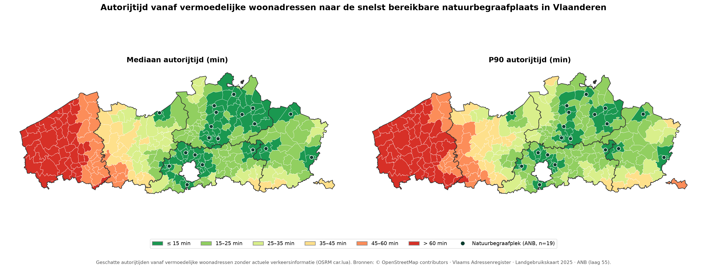
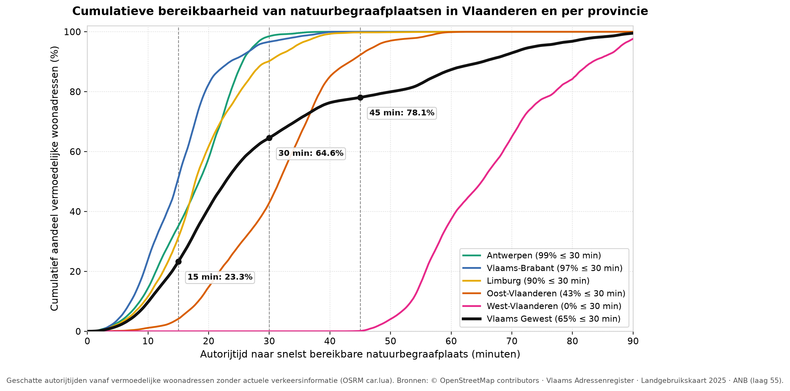
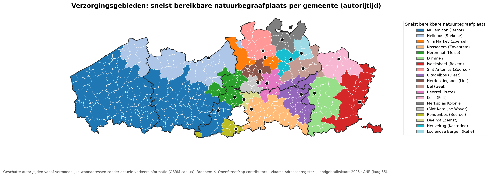

# Bereikbaarheid van natuurbegraafplaatsen in Vlaanderen

Reproduceerbare lokale analyse van de **autorijtijd vanaf vermoedelijke woonadressen in het Vlaamse Gewest naar de snelst bereikbare natuurbegraafplaats** (19 ANB-locaties, laag 55), inclusief bijbehorende rijafstand in kilometers, gerapporteerd voor Vlaanderen, per provincie en voor alle 285 Vlaamse gemeenten.

> **Disclaimer:** Alle resultaten betreffen geschatte autorijtijden zonder actuele verkeersinformatie (OSRM vast autoprofiel `car.lua`). De analyse-eenheid zijn **vermoedelijke woonadressen** (officiële actieve adressen uit het Vlaamse Adressenregister binnen de landgebruiksklasse *Huizen en tuinen*).

## Belangrijkste resultaten (heel Vlaanderen)

- **Geselecteerde vermoedelijke woonadressen:** `2.974.685` (`2.263.537` unieke vertrekpunten, **100,00%** routedekking)
- **Mediaan autorijtijd:** **22,8 min** (gemiddelde **30,3 min**, P90 **65,2 min**)
- **Aandeel binnen 15 / 30 / 45 min:** **23,3%** / **64,6%** / **78,1%**
- **Mediaan rijafstand:** **21,6 km** (gemiddelde **34,6 km**)
- **Sterk oost–west contrast:** in **Antwerpen** (98,5%), **Vlaams-Brabant** (96,6%) en **Limburg** (90,2%) bereikt vrijwel iedereen binnen 30 minuten een natuurbegraafplaats; in **Oost-Vlaanderen** is dat 42,9% en in **West-Vlaanderen** **0,0%** (mediaan 65,0 min).
- **Verzorgingsbereik:** twee locaties — *Muilemlaan (Ternat)* (32,1%) en *Hellebos (Stekene)* (12,5%) — zijn samen de snelste optie voor **44,6%** van alle Vlaamse woonadressen.







Zie ook:
- **Eindpaper:** [Markdown (`docs/paper_bereikbaarheid_natuurbegraafplaatsen.md`)](docs/paper_bereikbaarheid_natuurbegraafplaatsen.md) · [PDF (`outputs/paper_bereikbaarheid_natuurbegraafplaatsen.pdf`)](outputs/paper_bereikbaarheid_natuurbegraafplaatsen.pdf)
- [Volledige samenvatting (`outputs/full_samenvatting.md`)](outputs/full_samenvatting.md)
- [Methodenotitie (`docs/methodenotitie.md`)](docs/methodenotitie.md)
- [Interactieve Leaflet-kaart (`outputs/full_interactieve_kaart.html`)](outputs/full_interactieve_kaart.html)
- [Gemeentetabel CSV (`outputs/full_gemeenten_samenvatting.csv`)](outputs/full_gemeenten_samenvatting.csv)

## Projectstructuur

```text
├── docs/
│   ├── uitvoeringsplan.md         # Vastgelegd uitvoeringsplan
│   └── methodenotitie.md          # Methodenotitie, metingen en kanttekeningen
├── data/
│   ├── raw/                       # ANB-locaties + SOURCES.md (grote bronnen via .gitignore)
│   ├── interim/                   # Parquet tussenbestanden + hervatbare OSRM-cache
│   ├── osrm/                      # OSM PBF + OSRM CH-bestanden
│   └── processed/                 # Definitieve route-uitkomsten per vertrekpunt
├── outputs/                       # Tabellen, kaarten, grafieken en interactieve HTML-kaart
├── scripts/
│   └── setup_osrm.sh              # Reproduceerbare Docker OSRM-voorbereiding (v6.0.0, CH)
├── src/bereikbaarheid/            # Python-pakket en CLI
└── tests/                         # Gerichte synthetische unit- en integratietests
```

## Reproduceerbaar uitvoeren

Vereisten: Python 3.11+, [`uv`](https://docs.astral.sh/uv/) en Docker.

```bash
uv sync
uv run pytest
```

### 1. Bestemmingen & OSRM-snapping valideren

```bash
uv run bereikbaarheid validate-destinations
uv run bereikbaarheid validate-destinations --check-snapping --osrm-url http://localhost:5050
```

### 2. Adressenregister & Landgebruikskaart 2025 voorbereiden

Download de bronnen (zie [data/raw/SOURCES.md](data/raw/SOURCES.md)) en draai:

```bash
uv run bereikbaarheid prepare-addresses \
  --addresses data/raw/adressenregister/20261116_GRAR_Adressen_Data/Geopackage/GRAR_Adressen.gpkg \
  --layer Adres \
  --landuse-raster data/raw/landgebruik_2025/processed/lu_landgebruik_vlaa_2025_v3/lu_landgebruik_vlaa_2025_v3.tif \
  --residential-code 1 \
  --check-tolerance
```

### 3. Lokale OSRM-server opzetten (Docker + CH)

```bash
curl -L -o data/osrm/belgium-latest.osm.pbf https://download.geofabrik.de/europe/belgium-latest.osm.pbf
bash scripts/setup_osrm.sh belgium-latest.osm.pbf
docker run -d --name osrm-belgium -p 5050:5000 -v "$(pwd)/data/osrm:/data" \
  ghcr.io/project-osrm/osrm-backend:v6.0.0 \
  osrm-routed --algorithm ch --max-table-size 1000 --threads 8 /data/belgium-latest.osrm
```

### 4. Proefberekening (10.000 adressen), eindrun & visuals

```bash
# Proefberekening
uv run bereikbaarheid route --pilot-n 10000 --seed 42 --osrm-url http://localhost:5050 --batch-size 400

# Volledige eindrun voor heel Vlaanderen (hervatbaar via Parquet-cache)
uv run bereikbaarheid route --osrm-url http://localhost:5050 --batch-size 400

# Alleen visuals opnieuw genereren vanuit opgeslagen resultaten
uv run bereikbaarheid visualize --prefix full
```

## Bronvermelding

- Wegennet & routering: [© OpenStreetMap contributors](https://www.openstreetmap.org/copyright) (via OSRM)
- Adrespunten: Vlaams Adressenregister — Digitaal Vlaanderen (2026-11-16)
- Landgebruik: Landgebruik Vlaanderen, toestand 2025 v3 — Departement Omgeving
- Gemeentegrenzen: VRBG 2025 — Digitaal Vlaanderen
- Natuurbegraafplaatsen: Agentschap voor Natuur en Bos (ANB Belevingskaart, laag 55)
