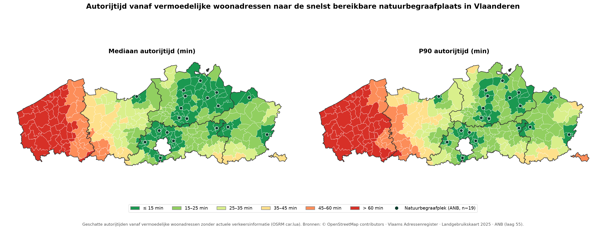
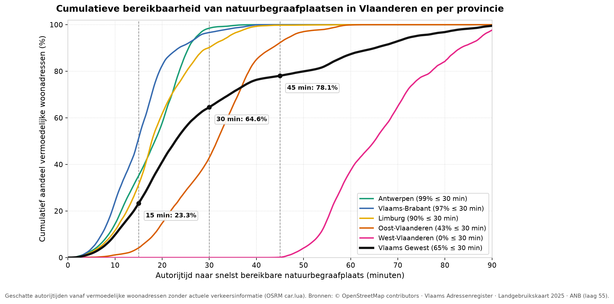
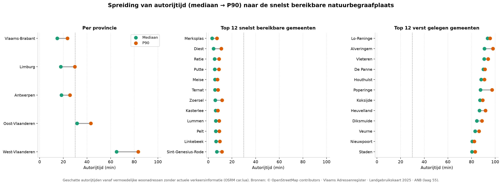
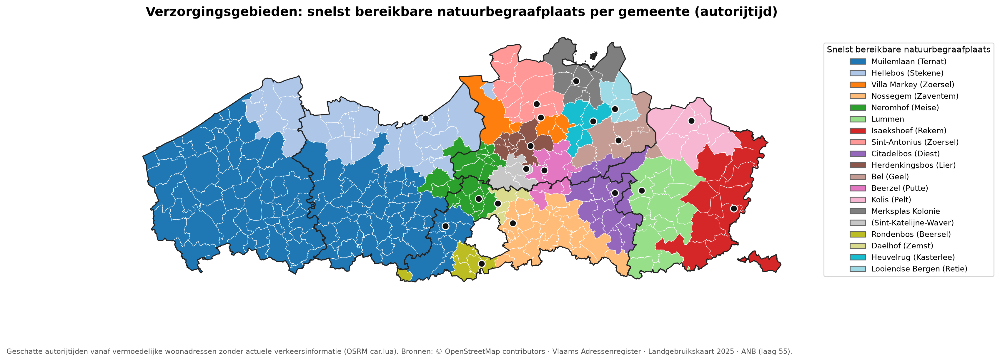
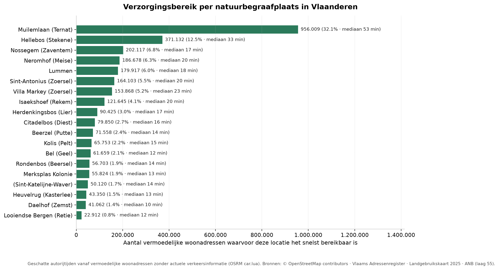

# Ruimtelijke bereikbaarheid van natuurbegraafplaatsen in Vlaanderen

**Een adresniveau-analyse op basis van het Vlaamse Adressenregister, de Landgebruikskaart 2025 en OpenStreetMap/OSRM**

*Versie 1.0 · 21 november 2026 · Reproduceerbare open-data-analyse (`bereikbaarheid-natuurbegraafplaatsen`)*

> **Leeswijzer en afbakening:** Alle gerapporteerde reistijden zijn geschatte autorijtijden zonder actuele verkeersinformatie (OSRM standaard autoprofiel `car.lua`). De analyse-eenheid zijn **vermoedelijke woonadressen** — officiële actieve adressen uit het Vlaamse Adressenregister die binnen de landgebruiksklasse *Huizen en tuinen* vallen.

---

## Samenvatting

Natuurbegraven wint in Vlaanderen aan belangstelling, maar het aanbod aan erkende natuurbegraafplekken is nog jong en geografisch ongelijk gespreid. In deze studie kwantificeren we op het hoogst mogelijke ruimtelijke detailniveau — alle **2.974.685 vermoedelijke woonadressen** in het Vlaamse Gewest — de geschatte autorijtijd en bijbehorende rijafstand naar de snelst bereikbare van de **19 natuurbegraafplekken** uit de Belevingskaart van het Agentschap voor Natuur en Bos (ANB, laag 55). Door exacte coördinaatgroepering worden deze adressen herleid tot **2.263.537 unieke vertrekpunten**, die volledig lokaal met OSRM (*Contraction Hierarchies*) op het OpenStreetMap-wegennet zijn doorgerekend (**100,00% routedekking**, nul ontbrekende routes).

De resultaten tonen een uitgesproken **oost–westkloof** in Vlaanderen:

- **Vlaams Gewest:** De gewogen mediaan autorijtijd bedraagt **22,8 minuten** (gemiddelde **30,3 min**, P90 **65,2 min**), bij een mediaan rijafstand van **21,6 km** (gemiddelde **34,6 km**). Van alle Vlaamse vermoedelijke woonadressen bereikt **23,3%** een natuurbegraafplaats binnen 15 minuten, **64,6%** binnen 30 minuten en **78,1%** binnen 45 minuten. Tegelijk liggen **376.075 woonadressen (12,6%)** op meer dan een uur rijden.
- **Provinciale verschillen:** In **Antwerpen** (98,5% binnen 30 min; mediaan 18,4 min), **Vlaams-Brabant** (96,6%; 14,8 min) en **Limburg** (90,2%; 17,8 min) is het aanbod goed gespreid. In **Oost-Vlaanderen** daalt het aandeel binnen 30 minuten naar **42,9%** (mediaan 31,6 min). In **West-Vlaanderen** — waar geen enkele van de 19 ANB-locaties ligt — bereikt **0,0%** van de 599.655 woonadressen een natuurbegraafplaats binnen 30 minuten (mediaan **65,0 min**, P90 **83,3 min**, mediaan afstand **87,6 km**).
- **Verzorgingsconcentratie:** Twee westelijk gelegen locaties — *Natuurbegraafplek Muilemlaan (Ternat)* (**956.009 adressen**, 32,1%) en *Natuurbegraafplek Hellebos (Stekene)* (**371.132 adressen**, 12,5%) — fungeren samen als snelst bereikbare bestemming voor **44,6%** van heel Vlaanderen.
- **Robuustheid:** Een gevoeligheidsanalyse waarin 140.560 adressen zonder busnummer binnen gemengde huisnummerfamilies worden weggelaten, wijzigt het Vlaamse gemiddelde met slechts **+0,12 minuten** en het aandeel binnen 30 minuten met **−0,48 procentpunt**.

---

## 1. Inleiding en onderzoeksvraag

Natuurbegraafplaatsen combineren een laatste rustplaats met duurzaam natuurbeheer. Voor nabestaanden die een graf willen bezoeken speelt de fysieke bereikbaarheid een directe rol in de toegankelijkheid van dit aanbod. Hoewel het Agentschap voor Natuur en Bos (ANB) de geregistreerde natuurbegraafplekken ontsluit via de Belevingskaart, ontbrak tot dusver een transparante, volledig reproduceerbare bereikbaarheidsanalyse op adresniveau voor heel Vlaanderen.

Deze paper beantwoordt drie concrete vragen:

1. **Hoe lang en hoe ver** moeten bewoners in het Vlaamse Gewest met de wagen rijden vanaf hun woonlocatie naar de snelst bereikbare ANB-natuurbegraafplaats?
2. **Hoe sterk verschilt die bereikbaarheid** tussen provincies, centrumsteden en de 285 Vlaamse gemeenten?
3. **Hoe groot is het potentiële verzorgingsgebied** van elk van de 19 bestaande locaties, en waar bevinden zich de grootste geografische witte vlekken?

Om de analyse transparant, verifieerbaar en herhaalbaar te houden, is de volledige dataverwerking en routering lokaal uitgevoerd op open overheidsdata en OpenStreetMap, met expliciete validatie van datakwaliteit, aansluiting op het wegennet en gevoeligheid voor adresdefinities.

---

## 2. Data en bronselectie

De analyse combineert vijf open databronnen, alle herleid tot exacte versies en peildatums (Tabel 1).

| Bron | Versie / peildatum | CRS | Omvang en rol |
|---|---|---|---|
| **ANB Belevingskaart (laag 55)** | Opgehaald 2026-11-21 (`Belevingssite/MapServer/55`) | `EPSG:31370` & `EPSG:4326` | 19 erkende natuurbegraafplekken (`TerraId` als stabiele ID) |
| **Vlaams Adressenregister (`GRAR_Adressen.gpkg`)** | 2026-11-16 (`Latest_event_id: 142126457`, product `10145`) | `EPSG:31370` | 4.627.123 ruwe rijen; 3.876.738 actieve officiële adressen |
| **Landgebruikskaart Vlaanderen 2025 (`v3`)** | Gepubliceerd 2026-06-01, gewijzigd 2026-06-18 | `EPSG:31370` | 10 m × 10 m GeoTIFF (`9200 × 23700`); code `1` = *Huizen en tuinen*, NoData = `-9999` |
| **OpenStreetMap (Geofabrik België)** | Timestamp `2026-11-20T21:21:21Z` (`belgium-latest.osm.pbf`) | `EPSG:4326` | Wegennet voor lokale OSRM-routering (`v6.0.0`, `car.lua`, CH) |
| **VRBG 2025 gemeenten & provincies** | 2025 (`VRBG2025:Refgem`, `Refprv`, WFS) | `EPSG:31370` | 285 Vlaamse gemeenten (post-fusie 2025) en 5 provincies |

### Geografische spreiding van de 19 bestemmingen

Uit de ArcGIS REST-dienst van het ANB werden zonder datatruncatie 19 puntlocaties opgehaald (`exceededTransferLimit: false`). Hun provinciale verdeling verklaart op voorhand een belangrijk deel van het ruimtelijke patroon:

- **Antwerpen (9 locaties):** Sint-Antonius (Zoersel), Villa Markey (Zoersel), Merksplas Kolonie, Looiendse Bergen (Retie), Heuvelrug (Kasterlee), Bel (Geel), Herdenkingsbos (Lier), Beerzel (Putte) en Sint-Katelijne-Waver.
- **Vlaams-Brabant (6 locaties):** Muilemlaan (Ternat), Neromhof (Meise), Daelhof (Zemst), Nossegem (Zaventem), Rondenbos (Beersel) en Citadelbos (Diest).
- **Limburg (3 locaties):** Kolis (Pelt), Lummen en Isaekshoef (Rekem).
- **Oost-Vlaanderen (1 locatie):** Hellebos (Stekene).
- **West-Vlaanderen (0 locaties):** Geen enkele geregistreerde ANB-natuurbegraafplek in laag 55.

---

## 3. Methodologie

### 3.1 Selectie van vermoedelijke woonadressen

Uit het Vlaamse Adressenregister (`GRAR_Adressen.gpkg`, laag `Adres`) zijn alle actieve (`status = 'InGebruik'`) en officieel toegekende (`offtoegknd = 'T'`) adressen geselecteerd. Dit levert exact **3.876.738** unieke actieve adressen op, met een 100%-overeenkomst op alle 285 NIS-gemeentecodes uit VRBG 2025, nul ontbrekende geometrieën, nul dubbele `adresid`'s en nul dubbele actieve adreslabels. Huis- en busnummers zijn als tekst bewaard en elk uniek adres inclusief busnummer telt als één eenheid.

Vervolgens is per adrespunt rechtstreeks de 10 m-cel uit de **Landgebruikskaart Vlaanderen 2025** (`lu_landgebruik_vlaa_2025_v3.tif`) uitgelezen in het gemeenschappelijke coördinatenstelsel `EPSG:31370`. Uit het officiële `.sld`-bestand blijkt code `1` ondubbelzinnig te staan voor **Huizen en tuinen** (`NoData = -9999`):

- **Geselecteerd (`Huizen en tuinen`):** **2.974.685** vermoedelijke woonadressen (**76,73%** van de actieve officiële adressen).
- **Uitgesloten (andere landgebruiksklasse):** 902.015 adressen, voornamelijk in *Diensten* (298.442), *Industrie* (161.585), *Commerciële doeleinden* (143.135) en *Transportinfrastructuur* (93.963).
- **Uitgesloten (`NoData` / buiten raster):** 38 adressen op `NoData`, 0 buiten het raster.

Omdat het Adressenregister geen afzonderlijke woonfunctie per adres of appartement bevat en het 10 m-raster perceels- of celniveau weerspiegelt, hanteren we consequent de term **vermoedelijke woonadressen**. Het Gebouwenregister en OSM-gebouwtags vallen bewust buiten deze eerste uitvoering.

### 3.2 Busnummervariant (gevoeligheidsanalyse)

Bij meergezinswoningen komt naast afzonderlijke busadressen soms ook een actief adres zonder busnummer voor (bijvoorbeeld een hoofdingang of een gelijkvloers pand). Op basis van de sleutel `(gemeenteid, gemeentenm, straatnmid, huisnr)` zijn alle **206.535** gemengde huisnummerfamilies geïdentificeerd. In de **hoofdanalyse** blijven alle 2.974.685 geselecteerde adressen behouden. In een aparte **busnummervariant** valt een adres zonder busnummer weg *indien minstens één busadres binnen dezelfde familie ook geselecteerd is*. Dat betreft **140.560 adressen** (resulterend in 2.834.125 adressen).

### 3.3 Exacte coördinaatgroepering

Meerdere busadressen binnen hetzelfde appartementsgebouw delen vaak exact dezelfde Lambert 72-coördinaat. Door te groeperen op exacte `(X, Y)`-coördinaten — zonder enige ruimtelijke afronding — worden de 2.974.685 geselecteerde adressen herleid tot **2.263.537 unieke vertrekpunten** (deduplicatieratio **1,314×**). Elk vertrekpunt krijgt een deterministische `origin_id` (SHA-256-hash van het exacte coördinaatpaar) en een volledige koppeltabel naar de onderliggende adressen, zodat gemeentelijke en variantgewichten exact herrekend kunnen worden.

### 3.4 Lokale OSRM-routering

De autorijtijden en rijafstanden zijn lokaal berekend met de vastgelegde Docker-image `ghcr.io/project-osrm/osrm-backend:v6.0.0` (native `arm64`), het standaard autoprofiel `/opt/car.lua` en *Contraction Hierarchies* (`ch`). Per batch van 400 unieke vertrekpunten is één verzoek gestuurd naar de OSRM Table API (`annotations=duration,distance`) tegenover alle 19 bestemmingen (totaal **43.007.203** herkomst–bestemmingsparen).

Per vertrekpunt wordt de bestemming met de **laagste gerapporteerde reistijd** gekozen en wordt de **rijafstand (km) uit exact dezelfde matrixcel** overgenomen. Eventuele gelijke reistijden worden deterministisch gebroken op stabiele `(destination_id, entrance_id)`. Er is geen `fallback_speed` gebruikt; `null`-cellen (*geen route*) en technische HTTP/API-fouten worden strikt gescheiden bijgehouden met automatische batch-splitsing bij fouten. Resultaten zijn hervatbaar weggeschreven als Parquet-checkpoints.

### 3.5 Gewogen aggregatie

Voor Vlaanderen, de vijf provincies en alle 285 gemeenten zijn gewogen statistieken berekend met het aantal geselecteerde adressen per vertrekpunt (binnen de betrokken gemeente) als gewicht. De expliciete noemer voor reistijd- en afstandsstatistieken is het aantal adressen met een geldige route. Het 90e percentiel (**P90**) is gedefinieerd als de eerste reistijd waarbij het cumulatieve gewicht minstens 90% van het geldige gewicht bereikt.

---

## 4. Resultaten

### 4.1 Vlaanderen als geheel

Alle **2.974.685** geselecteerde vermoedelijke woonadressen leverden een geldige autoroute op (**100,00% routedekking**, `0` *no_route*, `0` *api_error*). Tabel 2 vat de hoofdindicatoren voor het Vlaamse Gewest samen.

| Indicator (Vlaams Gewest, hoofdanalyse) | Waarde |
|---|---:|
| Geselecteerde vermoedelijke woonadressen | 2.974.685 |
| Unieke exacte vertrekpunten | 2.263.537 |
| Routedekking (`ok` / `no_route` / `api_error`) | 100,00% (2.974.685 / 0 / 0) |
| Gewogen gemiddelde autorijtijd | **30,26 min** |
| Gewogen mediaan autorijtijd | **22,80 min** |
| P90 autorijtijd | **65,18 min** |
| Aandeel binnen 15 minuten | **23,26%** (691.794 adressen) |
| Aandeel binnen 30 minuten | **64,57%** (1.920.869 adressen) |
| Aandeel binnen 45 minuten | **78,08%** (2.322.496 adressen) |
| Aandeel binnen 60 minuten | **87,36%** (2.598.610 adressen) |
| Aandeel boven 60 minuten | **12,64%** (376.075 adressen) |
| Gewogen gemiddelde rijafstand | **34,64 km** |
| Gewogen mediaan rijafstand | **21,57 km** |

Het grote verschil tussen de mediaan (**22,8 min**) en het gemiddelde (**30,3 min**) — en vooral het hoge 90e percentiel (**65,2 min**) — wijst op een sterk rechts-scheve verdeling: bijna twee derde van Vlaanderen woont op minder dan een halfuur, maar ruim een achtste van alle Vlaamse woonadressen moet meer dan een uur rijden (met een maximum van 104,8 minuten en 141,5 km in de Westhoek).

### 4.2 Een uitgesproken oost–westkloof tussen provincies en gemeenten

De uitsplitsing per provincie (Tabel 3) en de gemeentekaart (Figuur 1) maken duidelijk dat die scheve verdeling bijna volledig samenvalt met de geografische oost–westas.

| Provincie | Woonadressen | Gemiddelde | Mediaan | P90 | ≤ 15 min | ≤ 30 min | ≤ 45 min | Mediaan km |
|---|---:|---:|---:|---:|---:|---:|---:|---:|
| **Vlaams-Brabant** | 513.811 | 15,1 min | 14,8 min | 23,5 min | 51,2% | **96,6%** | 100,0% | 11,3 km |
| **Limburg** | 380.058 | 18,9 min | 17,8 min | 29,8 min | 31,3% | **90,2%** | 99,8% | 17,0 km |
| **Antwerpen** | 801.431 | 17,7 min | 18,4 min | 25,6 min | 35,1% | **98,5%** | 100,0% | 14,5 km |
| **Oost-Vlaanderen** | 679.730 | 31,0 min | 31,6 min | 43,3 min | 4,2% | **42,9%** | 92,3% | 33,2 km |
| **West-Vlaanderen** | 599.655 | **66,3 min** | **65,0 min** | **83,3 min** | **0,0%** | **0,0%** | **0,1%** | **87,6 km** |

De cumulatieve bereikbaarheidscurve (Figuur 2) illustreert de kloof in één oogopslag: terwijl de curven voor Vlaams-Brabant, Antwerpen en Limburg rond 30 minuten al bijna op 100% zitten, komt de curve van West-Vlaanderen pas voorbij 45 minuten los van de nul-as en kruist ze de 50%-lijn pas rond **65 minuten**.

Op gemeenteniveau (n = 285):
- **181 gemeenten** hebben een mediaan rijtijd van hoogstens 30 minuten (waarvan **141 gemeenten** 100% dekking binnen 30 minuten halen en **78 gemeenten** een mediaan ≤ 15 minuten kennen).
- **104 gemeenten** hebben een mediaan boven 30 minuten, **69 gemeenten** boven 45 minuten en **45 gemeenten** boven 60 minuten.
- In **88 gemeenten** (volledig West-Vlaanderen en een deel van West-/Zuid-Oost-Vlaanderen en Voeren) bereikt **0%** van de adressen een natuurbegraafplaats binnen 30 minuten.

### 4.3 Centrumsteden en gemeentelijke uitersten

Ook tussen de Vlaamse centrumsteden is het contrast scherp (Tabel 4). Waar Turnhout, Mechelen, Hasselt, Leuven, Aalst, Genk, Sint-Niklaas en Antwerpen vrijwel volledig binnen 30 minuten liggen, valt **Gent** (118.052 woonadressen, mediaan **35,3 min**) op met amper **1,0%** binnen 30 minuten. De West-Vlaamse centrumsteden liggen op bijna een uur tot ruim vijf kwartier rijden.

| Stad / referentiegemeente | Provincie | Woonadressen | Mediaan | P90 | ≤ 30 min | Mediaan km | Snelste locatie |
|---|---|---:|---:|---:|---:|---:|---|
| **Turnhout** | Antwerpen | 21.515 | 13,7 min | 16,1 min | 100,0% | 10,1 km | Merksplas Kolonie |
| **Mechelen** | Antwerpen | 36.644 | 15,9 min | 18,1 min | 100,0% | 10,8 km | Sint-Katelijne-Waver |
| **Hasselt** | Limburg | 38.885 | 16,6 min | 20,3 min | 99,9% | 17,3 km | Lummen |
| **Leuven** | Vlaams-Brabant | 68.916 | 17,1 min | 19,3 min | 100,0% | 18,1 km | Nossegem (Zaventem) |
| **Aalst** | Oost-Vlaanderen | 34.891 | 18,0 min | 22,5 min | 100,0% | 17,3 km | Muilemlaan (Ternat) |
| **Genk** | Limburg | 25.518 | 18,3 min | 21,4 min | 100,0% | 20,6 km | Isaekshoef (Rekem) |
| **Sint-Niklaas** | Oost-Vlaanderen | 33.160 | 21,0 min | 24,3 min | 100,0% | 13,6 km | Hellebos (Stekene) |
| **Antwerpen** | Antwerpen | 226.892 | 23,3 min | 26,9 min | 99,4% | 24,4 km | Villa Markey (Zoersel) |
| **Gent** | Oost-Vlaanderen | 118.052 | **35,3 min** | 38,8 min | **1,0%** | 42,8 km | Muilemlaan (Ternat) |
| **Kortrijk** | West-Vlaanderen | 34.578 | **57,4 min** | 60,6 min | **0,0%** | 81,4 km | Muilemlaan (Ternat) |
| **Brugge** | West-Vlaanderen | 58.486 | **57,6 min** | 59,8 min | **0,0%** | 67,5 km | Hellebos (Stekene) |
| **Oostende** | West-Vlaanderen | 36.449 | **69,3 min** | 71,2 min | **0,0%** | 101,4 km | Muilemlaan (Ternat) |
| **Roeselare** | West-Vlaanderen | 26.476 | **71,7 min** | 73,8 min | **0,0%** | 90,9 km | Muilemlaan (Ternat) |
| **Ieper** | West-Vlaanderen | 15.964 | **77,6 min** | 81,3 min | **0,0%** | 110,7 km | Muilemlaan (Ternat) |

De vijf snelst bereikbare gemeenten (mediaan) zijn **Merksplas** (3,2 min), **Diest** (4,4 min), **Retie** (5,3 min), **Putte** (5,4 min) en **Meise** (5,6 min) — alle gastgemeenten van een bestaande natuurbegraafplaats. Aan het andere uiterste liggen vijf Westhoek- en kustgemeenten: **Lo-Reninge** (93,5 min; 132,4 km), **Alveringem** (90,9 min), **Vleteren** (90,6 min), **De Panne** (90,0 min) en **Houthulst** (88,2 min) (Figuur 3).

### 4.4 Verzorgingsgebieden en druk op bestaande locaties

Wanneer elke gemeente en elk adres wordt toegewezen aan de snelst bereikbare natuurbegraafplaats, ontstaat een sterk asymmetrische verdeling (Figuren 4 en 5):

- **Muilemlaan (Ternat)** bedient als snelste optie **956.009 woonadressen (32,1% van Vlaanderen)** — waaronder 83,0% van West-Vlaanderen en 57,4% van Oost-Vlaanderen — met een mediaan aanrijtijd van **52,7 min** (70,8 km).
- **Hellebos (Stekene)** bedient **371.132 woonadressen (12,5%)** — vooral het noorden van Oost- en West-Vlaanderen (inclusief Brugge en Knokke-Heist) — met een mediaan van **33,5 min**.
- Samen zijn deze **twee locaties** de dichtstbijzijnde optie voor **44,6%** van alle Vlaamse woonadressen.
- De overige 17 locaties in Antwerpen, Vlaams-Brabant en Limburg bedienen elk tussen **22.912** (*Looiendse Bergen*, 0,8%) en **202.117** (*Nossegem*, 6,8%) adressen, met mediaan rijtijden tussen 10 en 23 minuten.

---

## 5. Validatie, prestaties en robuustheid

### 5.1 Steekproefpilot versus volledige eindrun

Vóór de eindrun is een reproduceerbare, over alle 285 gemeenten gestratificeerde proefberekening uitgevoerd van **10.000 adressen** (9.945 unieke vertrekpunten, `seed=42`). De pilot benaderde de volledige populatie van 2,97 miljoen adressen uiterst nauwkeurig (Tabel 5) en valideerde de doorvoersnelheid en datapipeline.

| Metriek | Pilot (10.000 adressen) | Volledige eindrun (2.974.685 adressen) |
|---|---:|---:|
| Unieke vertrekpunten | 9.945 | 2.263.537 (9.945 hergebruikt uit pilot-cache) |
| Routedekking | 100,00% | 100,00% |
| Gemiddelde autorijtijd | 30,15 min | 30,26 min |
| Mediaan autorijtijd | 22,80 min | 22,80 min |
| P90 autorijtijd | 64,86 min | 65,18 min |
| Aandeel binnen 30 min | 65,32% | 64,57% |
| Gemeten routeringsduur | 1,47 s (1 worker, 6.782/s) | 54,2 s (6 workers, 41.583/s) |

De volledige pipeline op een Apple Silicon-machine (24 GB RAM, 10 cores) vroeg in totaal minder dan vier minuten rekentijd (**18,3 s** bronverwerking, **2 min 11 s** OSRM-extractie & -contractie met 3,82 GB piek-RAM, **54,2 s** routering) en **3,9 GB** schijfruimte.

### 5.2 Aansluiting op het wegennet (*snapping*)

- **Bestemmingen (n = 19):** Via OSRM `/nearest` sluiten alle 19 ANB-punten aan op lokale wegen tussen **6,2 m** (*Isaekshoef*, Daalbroekstraat) en **153,9 m** (*Muilemlaan*, Muilemlaan). Geen enkel punt sprong over naar een autosnelweg of onjuiste toegangsweg; ingangscorrecties (`overrides`) waren niet nodig.
- **Vertrekpunten (n = 2.263.537):** De mediaan snap-afstand bedraagt **17,2 m** (P90 `26,1 m`, P99 `63,1 m`, P99,9 `231,0 m`, maximum `1.462,7 m`). Slechts **1.921** unieke vertrekpunten (**0,085%**) overschrijden de gekozen signaleringsgrens van `250 m`.

### 5.3 Robuustheid: busnummervariant en ruimtelijke tolerantie

- **Busnummervariant:** Het uitsluiten van de 140.560 adressen zonder busnummer binnen gemengde families heeft een minimaal effect op de Vlaamse uitkomsten: gemiddelde **+0,119 min**, P90 **+0,050 min**, aandeel binnen 30 min **−0,482 procentpunt** (`64,57%` → `64,09%`). De conclusies zijn dus ongevoelig voor mogelijke dubbeltellingen van hoofdingangen.
- **Ruimtelijke tolerantie Landgebruikskaart (±1 cel / 10 m):** Van de 902.015 adressen buiten *Huizen en tuinen* ligt 46,8% (421.968 adressen) binnen één rastercel (10 m) van *Huizen en tuinen* (typisch appartementen boven winkels of diensten, en adrespunten op de straatzijde of perceelsrand). Dit bevestigt waarom de resultaten als proxy (*vermoedelijke woonadressen*) geïnterpreteerd moeten worden.
- **Geautomatiseerde tests:** De volledige pijplijn wordt bewaakt door een `pytest`-testsuite (5/5 geslaagd) die expliciet het gedrag test op een rijhuis, meerdere busadressen op identieke coördinaten, gemengde families (met en zonder geselecteerd busadres), `NoData`/buiten-raster, `no_route` versus `api_error` met batch-splitsing, koppeling tussen snelste reistijd en bijbehorende kilometers, deterministische tie-breaking en gewogen gemeente-aggregatie met exacte P90.

---

## 6. Discussie, beperkingen en beleidsimplicaties

### Beleidsimplicaties

De ruimtelijke onevenwichtigheid in het huidige Vlaamse netwerk van ANB-natuurbegraafplekken is opvallend groot. Terwijl inwoners van Antwerpen, Vlaams-Brabant en Limburg doorgaans binnen 15 à 25 minuten een locatie bereiken, ligt het volledige grondgebied van West-Vlaanderen en grote delen van Oost-Vlaanderen (inclusief de stedelijke regio Gent) ver voorbij de 30-minutengrens.

Met het oog op toekomstige gebiedsontwikkeling of bijkomende erkenningen wijst deze analyse op twee duidelijke prioriteitsregio's:
1. **West-Vlaanderen (as Brugge–Roeselare–Kortrijk / Westhoek):** waar bijna 600.000 woonadressen vandaag mediaan meer dan een uur moeten rijden.
2. **Centraal- en West-Oost-Vlaanderen (regio Gent / Vlaamse Ardennen / Meetjesland):** waar één of twee bijkomende locaties niet alleen de reistijd voor honderdduizenden inwoners drastisch verlagen, maar ook de potentiële bezoekersdruk op *Muilemlaan (Ternat)* en *Hellebos (Stekene)* aanzienlijk kunnen verlichten.

### Methodologische beperkingen

1. **Vermoedelijke woonadressen (proxy):** De combinatie Adressenregister + Landgebruikskaart 2025 (10 m) onderscheidt geen individuele wooneenheden in gemengde panden (bijvoorbeeld wonen boven een handelszaak) en houdt geen rekening met huishoudgrootte of bevolkingsdichtheid. Een eventuele vervolgstudie kan het Gebouwenregister of Statbel-bevolkingsrasters integreren.
2. **Geen actuele verkeersinformatie:** OSRM berekent theoretische vrije-doorstromingsrijtijden. Rond structurele fileknelpunten (o.a. Antwerpse R1, Brusselse R0, E40 richting Ternat) liggen werkelijke rijtijden tijdens piekuren hoger.
3. **Grensoverschrijdend wegennet (`belgium-latest.osm.pbf`):** Het Belgische OSM-extract dekt alle 285 Vlaamse gemeenten inclusief Baarle-Hertog (mediaan 18,2 min naar Merksplas Kolonie). Voor de Limburgse exclave **Voeren** (1.857 woonadressen; <0,07% van Vlaanderen) dwingt het Belgische netwerk routes naar *Isaekshoef (Rekem)* via Belgisch grondgebied (mediaan 43,7 min; 34,6 km), terwijl een grensoverschrijdende route via Maastricht (NL) korter is. Op Vlaamse schaal beïnvloedt dit de eindcijfers niet, maar voor een lokale Voeren-analyse is een gecombineerd België+NL-Limburg-netwerk aan te raden.
4. **Afbakening aanbod en vervoersmodi:** Deze analyse beperkt zich tot de 19 locaties in ANB-laag 55 en uitsluitend tot verplaatsingen per auto. Eventuele gemeentelijke natuurbegraafzones buiten de ANB-laag, alsook bereikbaarheid per fiets of openbaar vervoer, vallen buiten de huidige scope.

---

## 7. Conclusie

Met open Vlaamse geodata en lokale OSRM-routering is voor alle **2.974.685 vermoedelijke woonadressen** in Vlaanderen een volledige, reproduceerbare nulmeting gemaakt van de autobereikbaarheid van natuurbegraafplaatsen. Vlaanderen scoort mediaan **22,8 minuten**, maar achter dat cijfer schuilt een scherpe geografische tweedeling: bijna volledige dekking binnen 30 minuten in Antwerpen, Vlaams-Brabant en Limburg tegenover **0,0% binnen 30 minuten in West-Vlaanderen** en een sterke concentratie van het verzorgingsbereik op twee locaties in Ternat en Stekene. De resultaten, kaarten en interactieve visualisatie vormen een directe empirische basis voor ruimtelijk beleid rond nieuwe natuurbegraafplaatsen in Vlaanderen.

---

## 8. Bronvermelding en reproduceerbaarheid

- **Wegennet en routering:** [© OpenStreetMap contributors](https://www.openstreetmap.org/copyright) (ODbL), via Geofabrik (`belgium-latest.osm.pbf`, 2026-11-20) en OSRM `v6.0.0`.
- **Adrespunten:** Digitaal Vlaanderen — *Gebouwen- en adressenregister: Adressen* (`GRAR_Adressen.gpkg`, versie 2026-11-16, Open Data License Vlaanderen).
- **Landgebruik:** Departement Omgeving / MercatorNet — *Landgebruik Vlaanderen, toestand 2025 (v3)* (`lu_landgebruik_vlaa_2025_v3.tif`, 10 m, EPSG:31370).
- **Bestuurlijke grenzen:** Digitaal Vlaanderen — *Voorlopig referentiebestand gemeentegrenzen 2025* (`VRBG2025:Refgem` en `VRBG2025:Refprv`).
- **Natuurbegraafplaatsen:** Agentschap voor Natuur en Bos (ANB) — *Belevingskaart*, laag 55 (*Natuurbegraafplek*, opgehaald 2026-11-21).
- **Code en interactieve kaart:** Alle scripts, tests, tabellen en de interactieve Leaflet-kaart (`outputs/full_interactieve_kaart.html`) zijn opgenomen in de repository `droes-m/bereikbaarheid-natuurbegraafplaatsen`.
